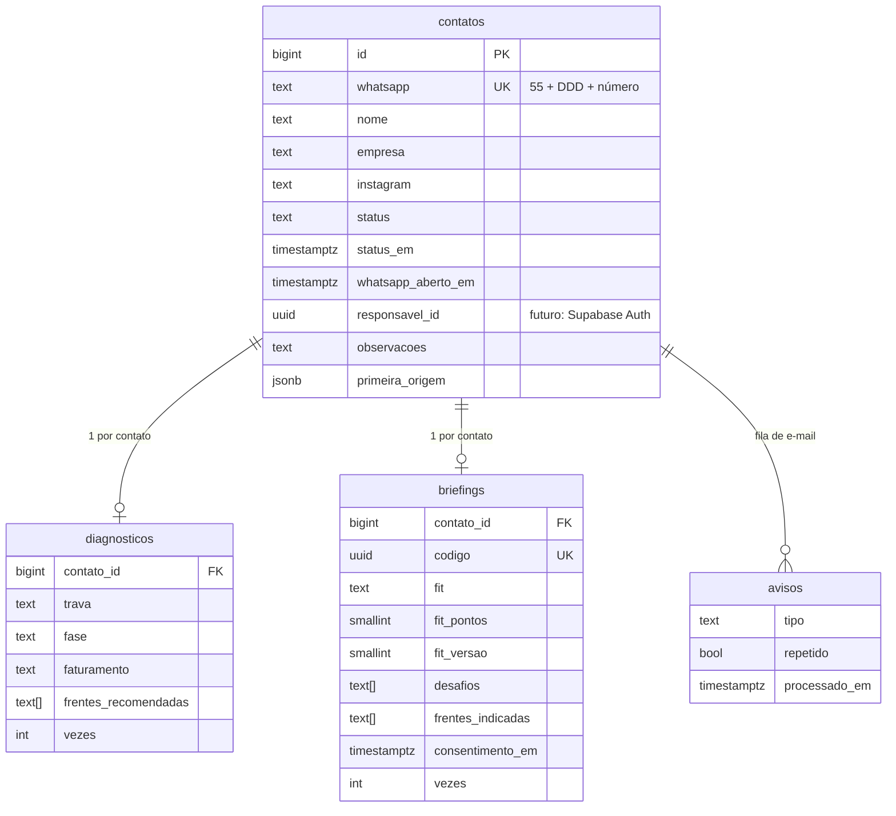

# 05. Banco de dados

Supabase, organização **SA Marketing**, projeto **SA Marketing**
(`yzarinssfqttxiqmkveo`), região **sa-east-1 (São Paulo)**, Postgres 17,
plano Free. Tudo no esquema **`comercial`**, fora da API pública do Supabase.

## Diagrama



## Tabelas

| Tabela | Uma linha por | Colunas principais |
|---|---|---|
| `contatos` | WhatsApp (único) | `whatsapp`, `nome`, `empresa`, `instagram`, `status`, `status_em`, `whatsapp_aberto_em`, `responsavel_id`, `observacoes`, `segue_instagram` (a equipe marca), `primeira_origem` (UTM, página e referrer da primeira vez), `criado_em`, `atualizado_em` |
| `diagnosticos` | contato | `trava`, `fase`, `faturamento`, `frente_de_interesse`, `frentes_recomendadas[]`, `utm`, `pagina`, `referrer`, `vezes` |
| `briefings` | contato | `segmento` (+`segmento_outro`), `tempo_mercado`, `produto_principal`, `faturamento`, `origem_clientes` (+`origem_outro`), `estrategia`, `marketing` (só com estratégia), `desafios[]` (+`desafio_outro`), `frentes_indicadas[]`, `decisao`, `prazo`, `investimento`, `objetivo`, `fit`, `fit_pontos`, `fit_versao`, `consentimento_em`, `codigo`, `utm`, `pagina`, `referrer`, `vezes` |
| `avisos` | envio novo (fila) | `tipo` (diagnostico/briefing), `contato_id`, `repetido`, `processado_em` (preenchido quando o e-mail sai) |
| `cliques` | dia + origem + destino | `total` (cliques da bio; nada sobre quem clicou) |
| `manutencao` | (uma só) | `ultimo_sinal`, `sinais` (cron que mantém o banco acordado) |

Regras gravadas no banco (CHECK): formato do WhatsApp, tamanhos de texto,
listas de valores aceitos de cada resposta (as versões antigas continuam
aceitas para não invalidar o histórico), status do funil, FIT.

**Repetição:** refazer o diagnóstico ou o briefing atualiza a linha do contato
e soma 1 em `vezes`. Empresa e Instagram vazios não apagam os já gravados.

**Gatilhos:** `atualizado_em` em toda alteração; `status_em` quando o status
muda; `avisos` recebe uma linha a cada envio novo (inserção ou `vezes`
mudando), não em edições da equipe nem em recálculo de FIT.

## Visões (para o painel)

| Visão | O que mostra |
|---|---|
| `comercial.leads` | Um contato por linha com tudo o que respondeu, FIT, status e horas no status. Mais quentes primeiro |
| `comercial.leads_esfriando` | `pendente-conversa` ou `abriu-whatsapp` há 2 h ou mais |
| `comercial.cliques_30_dias` | Cliques da bio por destino nos últimos 30 dias |

Ver no Supabase: **Table Editor** → seletor de esquema **comercial** → visão.

## Permissões

| Papel | Acesso |
|---|---|
| `anon`, `authenticated` (chaves públicas) | Nenhum (revogado; RLS sem política para eles) |
| `sa_site` (o site) | `select`, `insert`, `update` em `contatos`, `diagnosticos`, `briefings`, `manutencao`, `cliques`; `insert`, `select` e `update(processado_em)` em `avisos`. Sem `delete`, sem outros esquemas |
| `postgres` (dono) | Tudo; usado no painel e nas migrações |

Conexão do site: `DATABASE_URL` = pooler `aws-1-sa-east-1.pooler.supabase.com:6543`,
usuário `sa_site.yzarinssfqttxiqmkveo` (senha só na Vercel).

## Migrações (em ordem)

| Arquivo | O que faz |
|---|---|
| `20261111120000_comercial.sql` | Esquema, contatos, diagnósticos, briefings, avisos, manutenção, visão `leads`, RLS |
| `20261111190000_usuario_site.sql` | Papel `sa_site` e políticas (senha definida à parte) |
| `20261111210000_status_e_desafios.sql` | Status do funil, `status_em`, vários desafios, frentes, aceite, `codigo`, `leads_esfriando` |
| `20261113120000_cliques.sql` | Cliques da bio e `cliques_30_dias` |
| `20261118120000_briefing_v3.sql` | Tempo de mercado, produto, estratégia, impacto, novas listas; `sa_site` marca avisos |
| `20261119120000_instagram_sem_impacto.sql` | Sai a coluna `impacto`; entram `instagram_clicou_em`, `instagram_tela_em` e `contatos.segue_instagram`; visão `leads` com `clicou_seguir_instagram` |
| `20261119150000_sem_rastreio_instagram.sql` | Sai o rastreio do Instagram (`instagram_clicou_em`, `instagram_tela_em`); fica `contatos.segue_instagram` |

Para mudar o banco: criar uma migração nova (nunca editar as aplicadas),
testar num Postgres local aplicando todas em ordem (duas vezes, para provar
que repete sem erro), aplicar no Supabase (SQL Editor ou conector) e só então
publicar o código que depende dela.

## Consultas úteis (SQL Editor)

```sql
-- Leads mais quentes
select nome, empresa, whatsapp, fit, fit_pontos, status, horas_no_status
from comercial.leads limit 50;

-- Esfriando
select nome, whatsapp, status, horas_no_status from comercial.leads_esfriando;

-- Marcar atendimento
update comercial.contatos set status = 'em-atendimento' where whatsapp = '55DDDNUMERO';

-- Briefings da semana por FIT
select fit, count(*) from comercial.briefings
where criado_em > now() - interval '7 days' group by fit;

-- Avisos que não saíram por e-mail
select * from comercial.avisos where processado_em is null order by criado_em;

-- Excluir um contato (LGPD): apaga diagnóstico, briefing e avisos junto
delete from comercial.contatos where whatsapp = '55DDDNUMERO';
```
