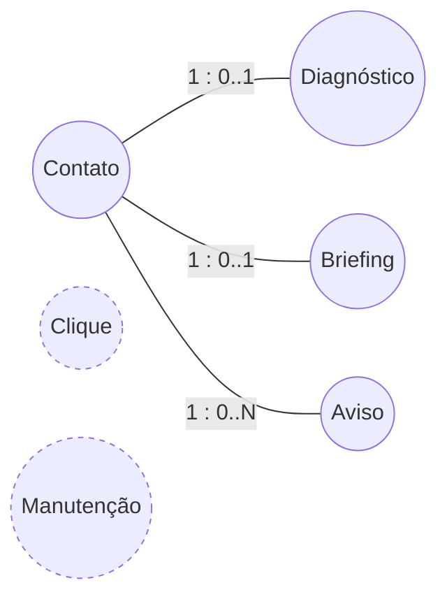
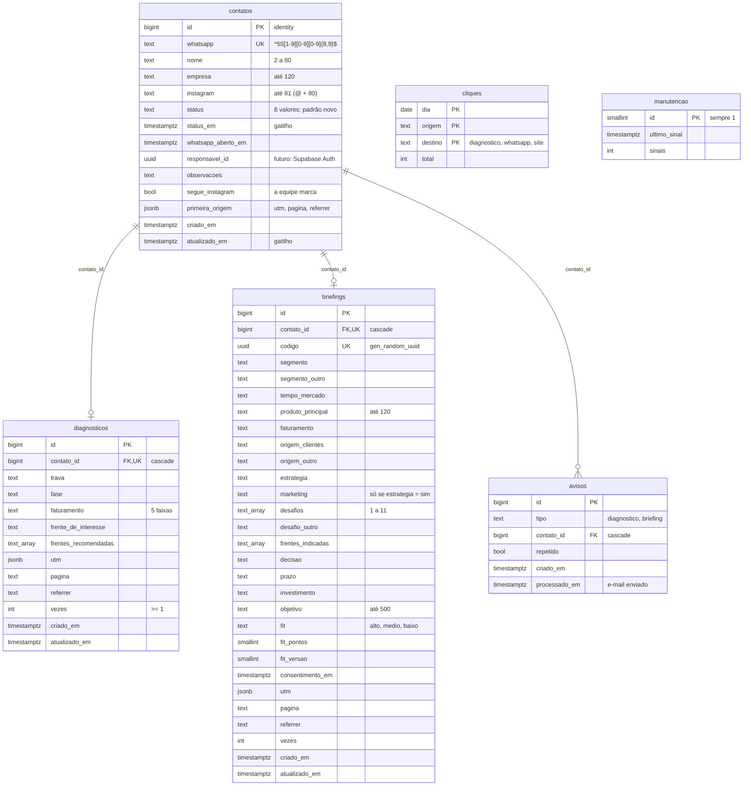
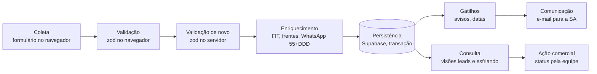
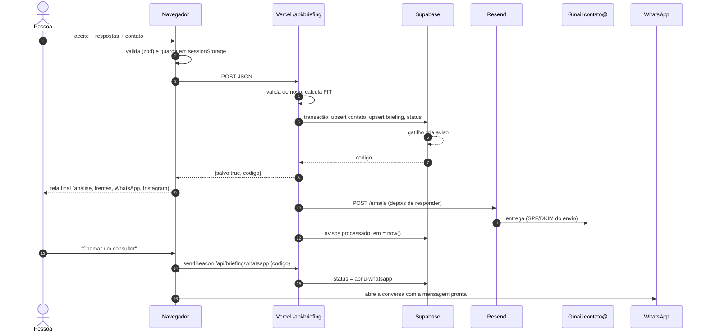
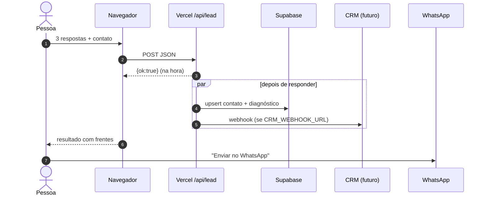
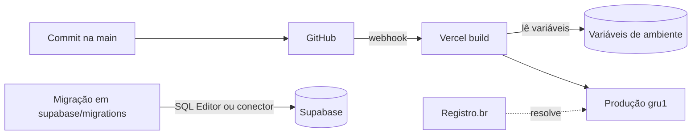

# 09. Modelo de dados e integrações

Conferido no banco de produção em 18/11/2026 (tabelas, colunas, chaves,
índices e gatilhos). Complementa o [05 Banco de dados](05-banco-de-dados.md).

## 1. Modelo conceitual (MER)

**Entidades**

| Entidade | O que representa | Identificador natural |
|---|---|---|
| Contato | Uma pessoa ou empresa que falou com a SA | WhatsApp (55 + DDD + número) |
| Diagnóstico | As 3 respostas do diagnóstico do site | O contato (1 por contato) |
| Briefing | O questionário antes da reunião, com o FIT | O contato (1 por contato); `codigo` para o clique final |
| Aviso | Um envio novo que precisa ser comunicado à SA | Sequencial |
| Clique | Total de toques num botão da bio, por dia | Dia + origem + destino |
| Manutenção | Sinal de vida do banco (cron) | Única |

**Relacionamentos**

- Contato **tem** 0 ou 1 Diagnóstico (1:0..1). Refazer atualiza o mesmo.
- Contato **tem** 0 ou 1 Briefing (1:0..1). Refazer atualiza o mesmo.
- Contato **gera** 0 ou N Avisos (1:0..N), um a cada envio novo.
- Clique e Manutenção são independentes: não identificam pessoas.



**Regras de negócio no modelo**

- O WhatsApp é a identidade do lead: o mesmo número no diagnóstico e no briefing é o mesmo contato.
- O status do funil fica no **contato**, não no briefing: é um só por pessoa.
- O FIT fica no **briefing**, com a versão da regra (`fit_versao`), para recalcular no futuro.
- Excluir um contato apaga diagnóstico, briefing e avisos dele (`on delete cascade`), o que atende ao pedido de exclusão da LGPD.

## 2. Diagrama entidade-relacionamento (DER)



## 3. Modelo relacional

Notação: **sublinhado = chave primária**, `→` = chave estrangeira,
`UK` = única. Todas no esquema `comercial`.

```
contatos     (_id_, whatsapp UK, nome, empresa, instagram, status, status_em,
              whatsapp_aberto_em, responsavel_id, observacoes, segue_instagram,
              primeira_origem,
              criado_em, atualizado_em)

diagnosticos (_id_, contato_id UK → contatos.id ON DELETE CASCADE, trava, fase,
              faturamento, frente_de_interesse, frentes_recomendadas[], utm,
              pagina, referrer, vezes, criado_em, atualizado_em)

briefings    (_id_, contato_id UK → contatos.id ON DELETE CASCADE, codigo UK,
              segmento, segmento_outro, tempo_mercado, produto_principal,
              faturamento, origem_clientes, origem_outro, estrategia, marketing,
              desafios[], desafio_outro, frentes_indicadas[], decisao,
              prazo, investimento, objetivo, fit, fit_pontos, fit_versao,
              consentimento_em, utm, pagina, referrer, vezes, criado_em,
              atualizado_em)

avisos       (_id_, tipo, contato_id → contatos.id ON DELETE CASCADE, repetido,
              criado_em, processado_em)

cliques      (_dia, origem, destino_, total)

manutencao   (_id_, ultimo_sinal, sinais)
```

**Normalização:** 3FN no essencial. Respostas de escolha ficam como texto
com lista fechada (CHECK) em vez de tabelas de domínio: as listas mudam
junto com o site (versionadas no código e na migração) e o histórico antigo
continua válido. `desafios` e `frentes_indicadas` são arrays porque são
listas curtas e sempre lidas inteiras; `utm` e `primeira_origem` são jsonb
porque o formato pode crescer.

**Índices**

| Tabela | Índice | Para quê |
|---|---|---|
| contatos | `contatos_whatsapp_key` (único) | Identidade do lead e upsert |
| contatos | `contatos_status_idx (status, criado_em desc)` | Funil por status |
| contatos | `contatos_esfriando_idx (status_em)` parcial | Leads esfriando, só os pendentes |
| diagnosticos / briefings | `*_contato_id_key` (único) | 1 por contato e upsert |
| briefings | `briefings_codigo_idx` (único) | Clique final pelo código |
| briefings | `briefings_fit_idx (fit, criado_em desc)` | Lista por FIT |
| avisos | `avisos_pendentes_idx (criado_em)` parcial | Fila do que falta enviar |
| avisos | `avisos_contato_idx` | Avisos de um contato |
| cliques | chave (dia, origem, destino) | Soma do dia (upsert) |

**Gatilhos**

| Gatilho | Quando | Faz |
|---|---|---|
| `*_atualizacao` | antes de update (contatos, diagnosticos, briefings) | `atualizado_em = now()` |
| `contatos_status` | antes de update em contatos | `status_em = now()` se o status mudou |
| `*_aviso_novo` | depois de insert (diagnosticos, briefings) | Cria um aviso |
| `*_aviso_refeito` | depois de update, só se `vezes` mudou | Cria um aviso com `repetido = true` |

**Visões:** `leads` (junta contato, diagnóstico e briefing; mais quentes
primeiro), `leads_esfriando` (filtro de `leads`), `cliques_30_dias`. Todas com
`security_invoker`, então respeitam as permissões de quem consulta.

## 4. Arquitetura de dados

### Onde cada dado vive

| Dado | Navegador | Vercel | Supabase | Resend | Google Workspace | WhatsApp |
|---|---|---|---|---|---|---|
| Respostas em andamento | `sessionStorage` (`sa:diagnostico`, `sa:briefing`), apagado ao fechar a aba | | | | | |
| Origem da visita (UTM, página, referrer) | `sessionStorage` (`sa:origem`) | | junto com o lead | | | |
| Lead (contato + respostas) | | só em trânsito, nunca em log | **fonte da verdade** | conteúdo do e-mail (registro do envio) | e-mail recebido | mensagem que a pessoa manda |
| FIT | nunca | calculado | `briefings` | no e-mail interno | e-mail interno | nunca |
| Status do funil | | | `contatos.status` | | | |
| Cliques da bio | | | `cliques` (só totais) | | | |
| Visitas | | Web Analytics (anônimo) | | | | |
| Métricas próprias (com aceite) | código aleatório do visitante | | banco de métricas (desligado hoje) | | | |

### Ciclo do dado



**Fonte da verdade:** o Supabase. O e-mail é um aviso; se falhar, o lead
continua no banco (e o aviso fica pendente em `avisos`).

**Retenção:** sem exclusão automática hoje. Exclusão a pedido, por WhatsApp
(ver 06). Definir prazo de retenção na política antes de escalar.

## 5. Como as ferramentas conversam

### Mapa de integrações

| De → para | Protocolo | Autenticação | O que passa | Se falhar |
|---|---|---|---|---|
| Navegador → Vercel (`/api/*`, `/ir`) | HTTPS (JSON; `sendBeacon` no clique) | Nenhuma; limite por IP, campo isca, validação | Respostas e contato | Briefing: tela pede o WhatsApp com as respostas; diagnóstico: segue para o WhatsApp |
| Vercel → Supabase | Postgres (TLS) pelo pooler Supavisor, porta 6543, modo transação | Usuário `sa_site` + senha (`DATABASE_URL`) | SQL parametrizado | Rota responde `salvo:false`; log só com o código do erro |
| Vercel → Resend | HTTPS `POST api.resend.com/emails` | Bearer `RESEND_API_KEY` (só envio, só o domínio `envio`) | Assunto, HTML, texto | Briefing segue gravado; aviso fica pendente |
| Resend → Google Workspace | SMTP pela infraestrutura do Resend (Amazon SES, `sa-east-1`) | SPF e DKIM do `envio.saagencia.com.br`; DMARC do domínio | O e-mail | Devolução vai para `send.envio` (MX de retorno) |
| Vercel Cron → Vercel (`/api/manter-banco`) | HTTPS GET | Bearer `CRON_SECRET` | Nada (sinal) | Supabase pode pausar após 7 dias; restaurar no painel |
| GitHub → Vercel | Webhook de push (integração Git) | App da Vercel no GitHub | Código da `main` | Deploy manual |
| Registro.br (DNS) → todos | DNS | DNSSEC desligado | Endereços, MX, SPF, DKIM, DMARC | Ver `docs/DNS.md` |
| Navegador → WhatsApp | Link `api.whatsapp.com/send` | Nenhuma | Mensagem pronta | Pessoa digita a mensagem |
| Agente (Claude) → Vercel, Supabase, Resend | Conectores MCP (OAuth) | Login de cada conta | Configuração, migrações, chaves, testes | Fazer pelo painel |

### Briefing, passo a passo



### Diagnóstico, passo a passo



### Bio, passo a passo

```mermaid
sequenceDiagram
  actor P as Pessoa no Instagram
  participant B as bio.saagencia.com.br
  participant V as Vercel /ir/destino
  participant S as Supabase
  P->>B: abre a bio (HTML do servidor)
  P->>V: toca num botão (/ir/diagnostico?de=bio)
  V-->>P: 302 para o site com ?diagnostico&utm_*
  V->>S: soma 1 em cliques (depois de responder; robôs não contam)
```

### Publicação e configuração


